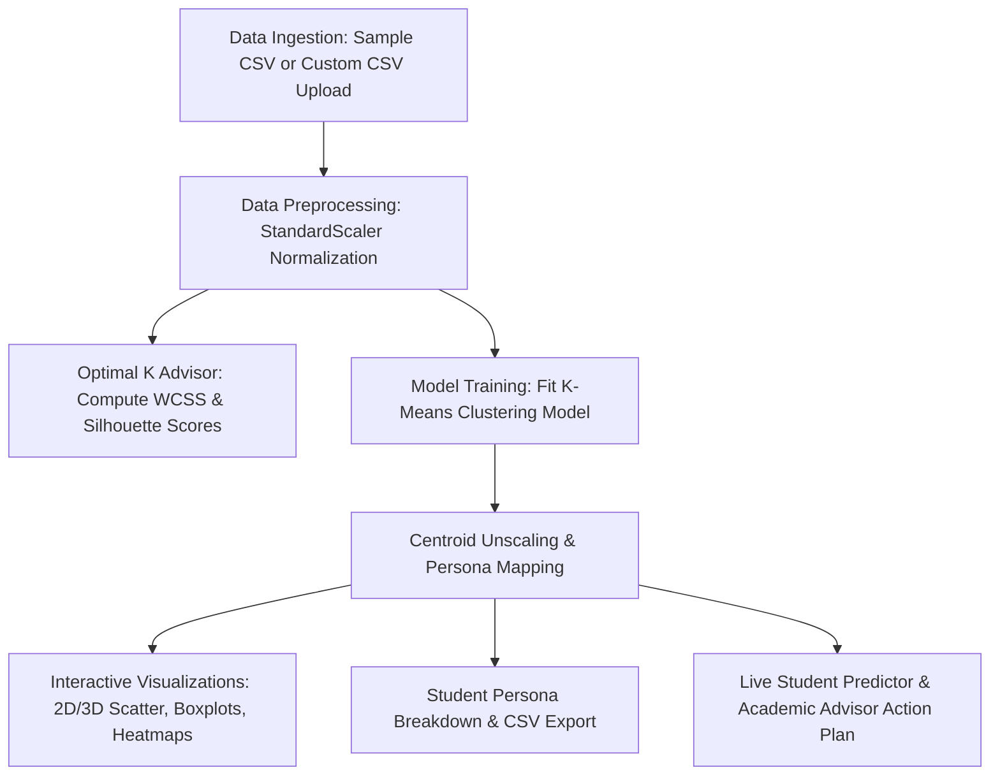

# 🎓 Student Performance Clustering System

An end-to-end Machine Learning web application and analytics platform built with **Python**, **Flask**, and **Scikit-Learn**.

The system helps educators and academic counselors group students into meaningful **Academic Personas** based on behavioral indicators — weekly study hours, attendance percentage, assignment scores, and exam results — using **Unsupervised K-Means Clustering**.

🔗 **Live Demo:** [student-performance-clustering-syst.vercel.app](https://student-performance-clustering-syst.vercel.app/)

---

## ✨ Features

- **Unsupervised K-Means Clustering** — segments students based on customizable behavioral metrics
- **Optimal K Advisor** — algorithmic recommendation using the Elbow Method and Silhouette Analysis
- **Automated Academic Persona Generation** — categorizes clusters into intuitive profiles:
  - 🌟 **High Performers** (Top Tier) — high study hours + high attendance
  - ⚠️ **At-Risk / Needs Intervention** — low study hours + low attendance
  - 📚 **Passive / Attentive Learners** — low study hours + high attendance
  - ⚡ **Independent / Self-Driven** — high study hours + low attendance
- **Interactive 2D & 3D Visualizations** — hover tooltips, centroid overlays, and rotational 3D plots powered by Plotly
- **Custom Data Support** — upload any CSV dataset or use the built-in 300-student synthetic generator
- **Real-Time Single Student Predictor** — predicts cluster membership for individual student metrics with tailored advisor recommendations
- **Exportable Results** — instant CSV download of the clustered dataset
- **Neumorphic UI** — white-and-blood-red default theme with an optional dark theme, soft raised surfaces, and subtle inset shadows

---

## 📁 Project Structure

```
Student Performance Clustering System/
├── app.py                              # Flask Web Server & REST API
├── templates/
│   └── index.html                      # Dashboard interface
├── static/
│   ├── styles.css                      # Responsive neumorphic design system
│   └── app.js                          # Dashboard interactions and visualizations
├── requirements.txt                    # Dependency specifications
├── test_clustering.py                  # Automated unit and integration test suite
├── data/
│   └── student_performance_sample.csv  # Pre-generated sample dataset (300 students)
└── utils/
    ├── data_generator.py               # Synthetic dataset generator engine
    ├── clustering.py                   # ML pipeline (scaling, K-Means, Elbow, Personas, Predictor)
    └── visualization.py                # Plotly interactive chart builders
```

---

## 📸 Screenshots


### 📊 Data Overview
KPI cards, dataset preview, summary statistics, and correlation heatmap.


### 📈 Optimal K Finder
Elbow Method (WCSS) and Silhouette Score analysis with recommended K.


### 🎨 Cluster Visualizer
2D/3D interactive scatter plots with centroid overlays and feature boxplots.


### 📋 Dataset & Personas
Color-coded persona breakdown cards with cluster filtering and CSV export.


### 🔮 Student Predictor
Live prediction form with persona badge and generated action plan.


### 🎨 White Neumorphic Interface
The default dashboard uses a predominantly white palette, subtle soft shadows, and blood-red highlights for controls, active navigation, and key information. The theme toggle switches to a complementary dark mode.

---

## 🛠️ Tech Stack

| Library | Purpose |
|---|---|
| `flask` | Backend REST API & routing |
| `pandas` / `numpy` | Data manipulation |
| `scikit-learn` | StandardScaler, KMeans, silhouette_score |
| `plotly` | Interactive 2D/3D visualizations (rendered client-side from JSON) |

---

## 🚀 Getting Started

### Prerequisites
- Python 3.9+
- pip

### Installation

```bash
# Clone the repository
git clone <repository-url>
cd "Student Performance Clustering System"

# Install dependencies
pip install -r requirements.txt
```

### Run the App

```bash
python app.py
```

The app will be available at `http://127.0.0.1:5000`.

### Run Tests

```bash
python -m pytest test_clustering.py
```

---

## 🧭 How It Works



1. **Data Ingestion** — load the built-in 300-student sample dataset or upload a custom CSV
2. **Preprocessing** — standardize selected features using `StandardScaler` (zero mean, unit variance)
3. **Optimal K Advisor** — compute WCSS (Elbow Method) and Silhouette Scores across K = 2 to 8
4. **Model Training** — fit `KMeans` (`n_init=10`) with the chosen number of clusters
5. **Centroid Unscaling & Persona Mapping** — inverse-transform centroids back to real units and assign academic archetypes based on median study hours/attendance splits
6. **Visualization & Insights** — explore results via 2D/3D scatter plots, boxplots, correlation heatmaps, persona breakdowns, CSV export, and a live single-student predictor

---

## 📊 Application Tabs

| Tab | Description |
|---|---|
| 📊 **Data Overview** | KPI cards (total students, features, means), sample preview, summary statistics, correlation heatmap |
| 📈 **Optimal K Finder** | Side-by-side Elbow (WCSS) and Silhouette Score plots with the recommended K highlighted |
| 🎨 **Cluster Visualizer** | 2D scatter with centroid overlays, optional 3D scatter (≥3 features), per-cluster feature boxplots |
| 📋 **Dataset & Personas** | Color-coded persona breakdown, cluster filtering, CSV export |
| 🔮 **Student Predictor** | Live form to predict an individual student's cluster and persona, with a generated action plan |

---

## 🧪 Sample Dataset

The synthetic dataset generator (`utils/data_generator.py`) produces 300 realistic student records across four behavioral archetypes:

| Persona | % of Cohort | Study Hours (μ, σ) | Attendance (μ, σ) |
|---|---|---|---|
| High Performers | 30% (90 students) | 22, 4 | 88%, 5 |
| At-Risk | 25% (75 students) | 6, 2.5 | 52%, 8 |
| Passive Learners | 25% (75 students) | 8, 2.5 | 85%, 6 |
| Independent Learners | 20% (60 students) | 20, 3.5 | 60%, 7 |

Values are clipped to realistic bounds (e.g., Study Hours: 1–35, Attendance: 35–100%) and paired with generated Student IDs (`STU-1001`–`STU-1300`) and names.

---

---

## 📘 Project Report

See the [full project report](./Student_Performance_Clustering_System_Project_Report.md) for the system design, methodology, implementation details, API specification, testing, and analysis.
